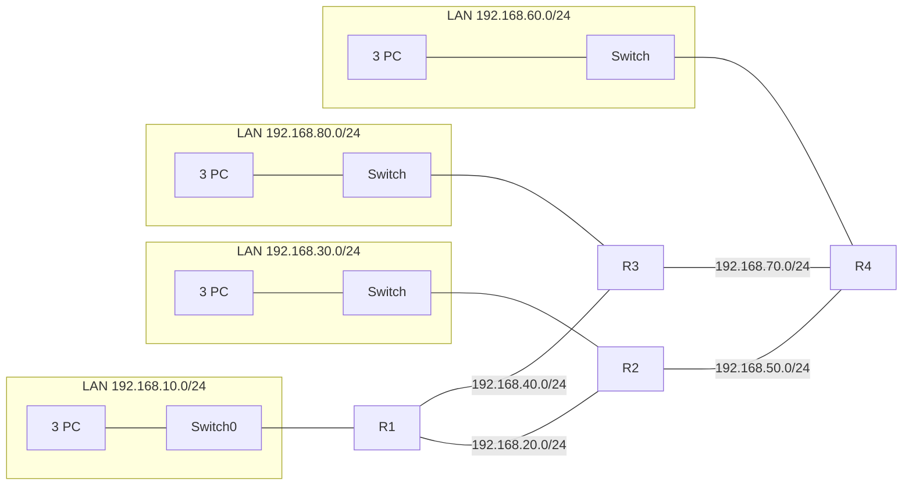
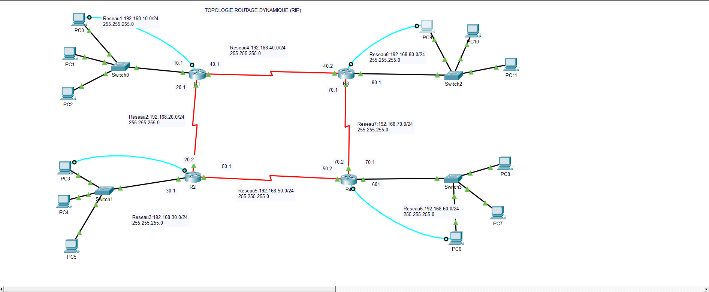
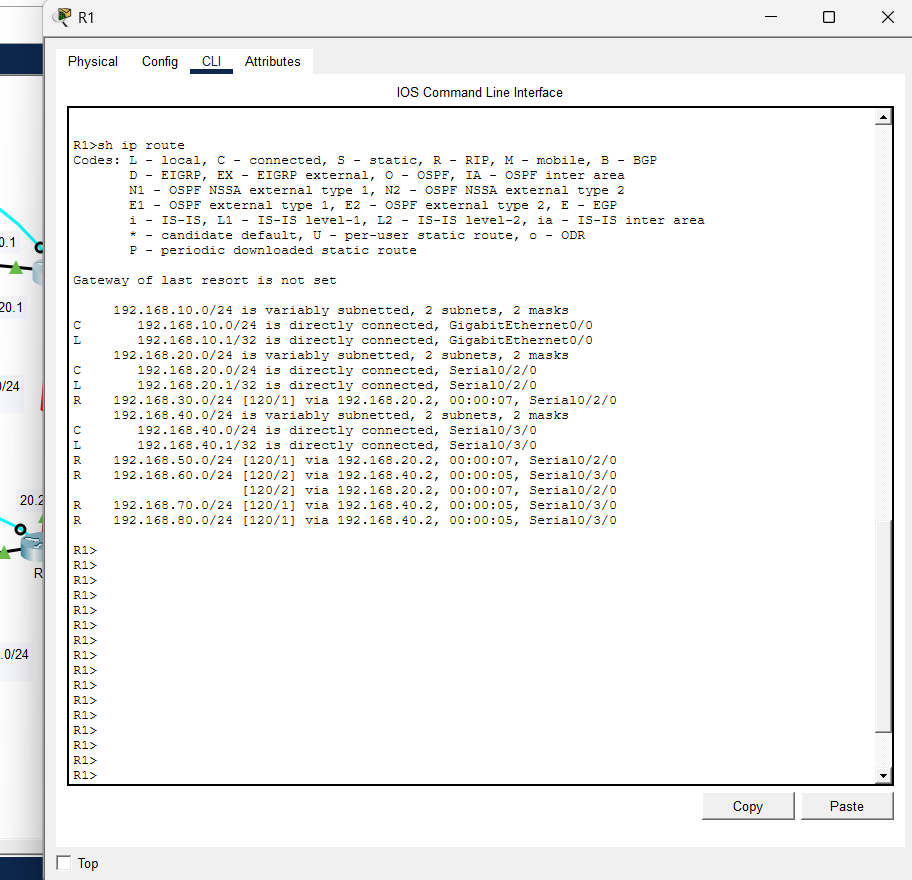
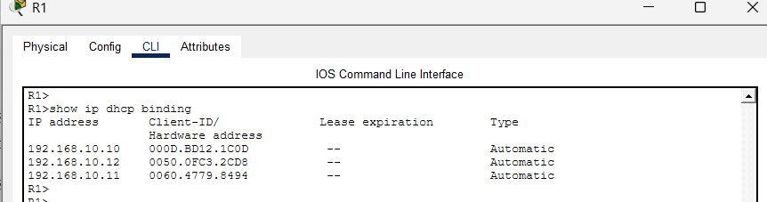
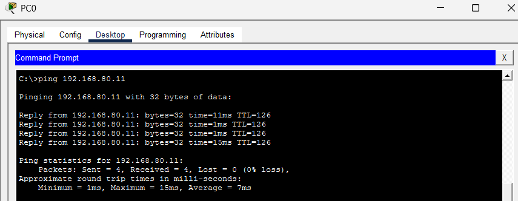

# Topologie à 4 routeurs : routage RIPv2 et DHCP (Cisco Packet Tracer)

Projet réalisé en B1 Réseaux et Cybersécurité (IMIE, Paris).

## Objectif

Interconnecter 4 réseaux locaux (un par routeur) grâce au routage dynamique **RIP version 2**, et distribuer automatiquement les adresses IP aux postes avec un **serveur DHCP configuré sur chaque routeur**.

## Outils

- Cisco Packet Tracer (version 9.0)
- 4 routeurs Cisco 2911, 4 switchs 2960, 12 PC
- Protocoles : RIPv2, DHCP

## Topologie

Les routeurs sont reliés en anneau par des liaisons série. Chaque routeur dessert un LAN (un switch et 3 PC).





## Plan d'adressage

| Routeur | Interface | Adresse IP | Réseau | Relié à |
|---|---|---|---|---|
| R1 | Gi0/0 | 192.168.10.1/24 | LAN 1 | Switch + PC |
| R1 | Se0/2/0 | 192.168.20.1/24 | Liaison R1-R2 | R2 |
| R1 | Se0/3/0 | 192.168.40.1/24 | Liaison R1-R3 | R3 |
| R2 | Gi0/0 | 192.168.30.1/24 | LAN 2 | Switch + PC |
| R2 | Se0/2/0 | 192.168.20.2/24 | Liaison R1-R2 | R1 |
| R2 | Se0/3/1 | 192.168.50.1/24 | Liaison R2-R4 | R4 |
| R3 | Gi0/0 | 192.168.80.1/24 | LAN 3 | Switch + PC |
| R3 | Se0/2/0 | 192.168.70.1/24 | Liaison R3-R4 | R4 |
| R3 | Se0/3/0 | 192.168.40.2/24 | Liaison R1-R3 | R1 |
| R4 | Gi0/0 | 192.168.60.1/24 | LAN 4 | Switch + PC |
| R4 | Se0/2/0 | 192.168.70.2/24 | Liaison R3-R4 | R3 |
| R4 | Se0/3/1 | 192.168.50.2/24 | Liaison R2-R4 | R2 |

## Configuration

### RIPv2 (exemple sur R1)

```
router rip
 version 2
 network 192.168.10.0
 network 192.168.20.0
 network 192.168.40.0
```

Chaque routeur annonce ses réseaux directement connectés (LAN et liaisons série) et apprend les autres automatiquement.

### DHCP (exemple sur R1)

```
ip dhcp excluded-address 192.168.10.1 192.168.10.9
ip dhcp excluded-address 192.168.10.100 192.168.10.254
ip dhcp pool Reseau1
 network 192.168.10.0 255.255.255.0
 default-router 192.168.10.1
```

Sur chaque LAN, les adresses .1 à .9 et .100 à .254 sont exclues : les PC reçoivent donc une adresse entre **.10 et .99**, avec la passerelle par défaut du routeur local.

Les configurations complètes des 4 routeurs sont dans le dossier `configs/`.

## Tests de validation

Les commandes à lancer et les captures à ajouter :

| Test | Commande | Résultat attendu |
|---|---|---|
| Table de routage | `show ip route` sur R1 | Routes RIP (`R`) vers 192.168.30.0, .50.0, .60.0, .70.0 et .80.0 |
| Protocole RIP | `show ip protocols` | RIPv2, réseaux annoncés |
| Baux DHCP | `show ip dhcp binding` | Adresses .10 à .99 attribuées |
| Connectivité | `ping` d'un PC du LAN 1 vers un PC du LAN 4 | Réponses reçues |
| Chemin | `tracert` du même PC | Passage par les routeurs intermédiaires |





## Ce que j'ai appris

- Concevoir un plan d'adressage pour plusieurs réseaux interconnectés
- Configurer le routage dynamique RIPv2 et vérifier la convergence
- Déployer un service DHCP sur un routeur avec plages d'exclusion
- Diagnostiquer un problème de connectivité (`ping`, `tracert`, table de routage)

## Pistes d'amélioration

- Ajouter `no auto-summary` et `passive-interface` sur les interfaces LAN
- Ajouter une option DNS dans les pools DHCP
- Migrer vers OSPF (voir mon projet suivant)

## Fichiers du dépôt

```
├── README.md
├── topologie_4routeurs_rip.pkt
├── configs/        (R1.txt, R2.txt, R3.txt, R4.txt)
└── images/         (topologie.png, show_ip_route.png, ping.png…)
```
